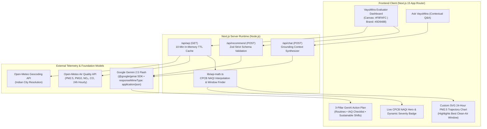

# 🍃 VayuMitra (वायुमित्र)
### *Urban Air Quality & Low-Emission Civic Companion for Indian Metros*

> **PromptWars Virtual Challenge 06 Entry** | Built with **Google Gemini 2.5 Flash**, **Next.js 15 (App Router)**, **TypeScript**, and **Tailwind CSS**.

[]()
[]()
[]()
[-ca8a04.svg)]()

---

## 🌟 Executive Overview & Problem Statement

Indian urban residents across Delhi NCR, Mumbai, Kolkata, Bengaluru, and tier-1/tier-2 cities face extreme seasonal pollution (often exceeding 300+ NAQI during winter temperature inversions). However, current platforms provide only passive, anxious red dashboards without actionable personal advice.

**VayuMitra ("Friend of the Air")** bridges atmospheric science and civic action:
1. **Never guesses AQI**: Pulls real-time atmospheric readings directly from verified Open-Meteo Air Quality telemetry.
2. **Official Indian CPCB NAQI Formula**: Calculates exact linear sub-indices across official Indian Central Pollution Control Board breakpoints for PM2.5 and PM10 (0–500 scale).
3. **24-Hour Clean-Air Window Engine**: Scans diurnal dispersion forecasts to identify today's lowest-pollution 2-hour window (e.g. `2:00 PM – 4:00 PM IST`) for safe cross-ventilation, laundry, and essential errands.
4. **Contextual GenAI Reasoning via Google Gemini 2.5 Flash**: Delivers a 3-pillar action plan tailored specifically to the resident's household profile (e.g. *Family with Kids*, *Senior Citizens / Asthma*, *Daily Commuters*, *Outdoor Athletes*) and home conditions.
5. **Contextual Civic Q&A**: Lets users ask follow-up questions grounded strictly in active telemetry.

---

## 🏛 Architecture Diagram



---

## 📐 Official CPCB NAQI Calculation Formula

In compliance with the **Central Pollution Control Board (CPCB)** guidelines:

$$I_p = \left[\frac{I_{Hi} - I_{Lo}}{B_{Hi} - B_{Lo}}\right] \times (C_p - B_{Lo}) + I_{Lo}$$

Where:
- $C_p$: Pollutant concentration
- $B_{Hi}, B_{Lo}$: Breakpoint concentrations enclosing $C_p$
- $I_{Hi}, I_{Lo}$: Sub-index values corresponding to $B_{Hi}, B_{Lo}$
- **Overall NAQI** = $\max(I_{PM2.5}, I_{PM10})$

### Official CPCB Breakpoints:
| Category | NAQI Scale | PM2.5 ($µg/m^3$) | PM10 ($µg/m^3$) | Dynamic Brand Palette |
| :--- | :--- | :--- | :--- | :--- |
| **Good** | 0 – 50 | 0 – 30 | 0 – 50 | `#15803D` |
| **Satisfactory** | 51 – 100 | 31 – 60 | 51 – 100 | `#65A30D` |
| **Moderate** | 101 – 200 | 61 – 90 | 101 – 250 | `#CA8A04` |
| **Poor** | 201 – 300 | 91 – 120 | 251 – 350 | `#EA580C` |
| **Very Poor** | 301 – 400 | 121 – 250 | 351 – 430 | `#DC2626` |
| **Severe** | 401 – 500 | 251 – 350+ | 431 – 500+ | `#7F1D1D` |

---

## 🚀 Quick Start & Local Setup

### 1. Clone & Install Dependencies
```bash
git clone https://github.com/your-username/vayumitra.git
cd vayumitra
npm install
```

### 2. Configure Environment Variables
Copy `.env.example` to `.env.local`:
```bash
cp .env.example .env.local
```

Add your Google Gemini API key:
```ini
GEMINI_API_KEY=AIzaSy...your_gemini_api_key_here
```
*(Get a free key from [Google AI Studio](https://aistudio.google.com/app/apikey). If left unset, VayuMitra automatically runs in high-fidelity scientific simulation mode so evaluators can test everything immediately without credentials.)*

### 3. Run Development Server
```bash
npm run dev
```
Open [http://localhost:3000](http://localhost:3000) in your browser.

---

## 🧪 Running Automated Tests

Run the full Vitest suite testing CPCB sub-index math, 24-hour clean-air window logic, API geocoding, and Zod schemas:
```bash
npm test
```

### Production Build
```bash
npm run build
```

---

## ☁️ Deployment Guide

### Deploy to Vercel
1. Push this repository to GitHub.
2. Import the project into [Vercel](https://vercel.com).
3. Under Environment Variables, add `GEMINI_API_KEY`.
4. Deploy! Next.js 15 App Router endpoints deploy automatically as edge/serverless functions.

### Deploy to Google Cloud Run (Container)
1. Build container: `docker build -t gcr.io/YOUR_PROJECT_ID/vayumitra .`
2. Push container: `docker push gcr.io/YOUR_PROJECT_ID/vayumitra`
3. Deploy:
```bash
gcloud run deploy vayumitra \
  --image gcr.io/YOUR_PROJECT_ID/vayumitra \
  --platform managed \
  --region asia-south1 \
  --allow-unauthenticated \
  --set-env-vars GEMINI_API_KEY="YOUR_KEY"
```

---

## 🛡 Security & Engineering Standards

- **Zero Client-Side Keys**: `GEMINI_API_KEY` is loaded strictly on the server (`/api/recommend`, `/api/chat`).
- **Resilient Timeouts**: All external network calls utilize `AbortController` with an 8-second circuit-breaker timeout.
- **Strict Typing**: TypeScript `strict: true` with zero `any` types.
- **Accessible & WCAG Compliant**: Full keyboard focus rings, `aria-live="polite"` telemetry announcements, high contrast slate text on white surfaces.

---

*Crafted for Hack2skill & Google's PromptWars Challenge 06.*
