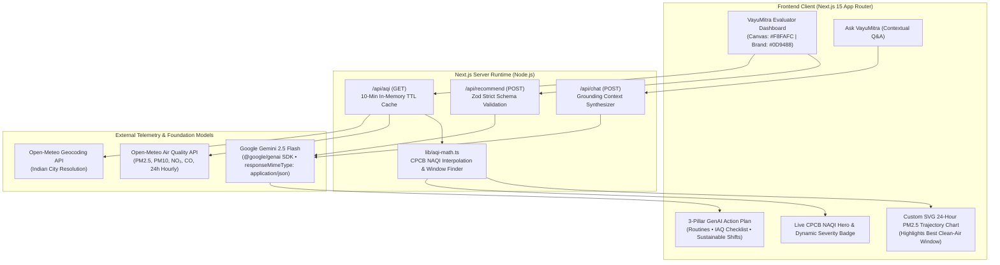

# 🍃 VayuMitra (वायुमित्र)
### *Urban Air Quality & Low-Emission Civic Companion for Indian Metros*

> **PromptWars Virtual Challenge 06 Entry** | Built with **Google Gemini 2.5 Flash**, **Next.js 15 (App Router)**, **TypeScript**, and **Tailwind CSS**.

[]()
[]()
[]()
[-ca8a04.svg)]()

---

## 🎯 Chosen Vertical & Persona Definition

* **Challenge Track:** **Challenge 06 — Indian Urban Air Quality & Low-Emission Civic Companion** *(Civic Tech / Environmental Health AI)*.
* **Problem Focus:** Transforming passive, panic-inducing Indian AQI numbers into actionable, personalized, low-emission daily routines for families and commuters across Indian metros.
* **Target Personas Supported:**
  1. **Family with Kids (Default):** Focus on school run exposure protection, bedroom air sealing, and preventing winter smog inhalation.
  2. **Senior Citizens / Asthma Patients:** Ultra-conservative exposure thresholds, indoor HEPA sanctuary guidance, and zero-strenuous outdoor activity during Poor/Severe AQI.
  3. **Daily Commuters (10+ km):** Tailpipe exposure avoidance, shifting from single-occupancy petrol vehicles to Metro/electric transit with N95 filtration.
  4. **Outdoor Athletes & Joggers:** Morning smog avoidance, scheduling training runs strictly within the verified clean-air window.

---

## 🧠 Approach and Logic

1. **Deterministic Atmospheric Ground Truth:**
   * Never hallucinate or predict air quality without telemetry. Live PM2.5, PM10, NO₂, and CO levels are fetched directly from Open-Meteo Air Quality telemetry and reverse-geocoded to the user's exact Indian locality using OpenStreetMap Nominatim.
2. **Official Indian CPCB Breakpoints:**
   * Adheres strictly to the Indian Central Pollution Control Board (CPCB) NAQI formula (0–500 scale) using piecewise linear interpolation, correctly identifying the dominant pollutant and official category (`Good`, `Satisfactory`, `Moderate`, `Poor`, `Very Poor`, `Severe`).
3. **24-Hour Clean-Air Window Engine:**
   * Analyzes diurnal boundary layer dispersion to detect the lowest-pollution 2-hour window (typically 1:00 PM – 4:00 PM IST) so households can ventilate without trapping morning inversion smog.
4. **Structured GenAI Context Synthesis:**
   * Sends verified telemetry, household persona, and lifestyle flags to **Google Gemini 2.5 Flash** using strict Zod schemas (`responseMimeType: application/json`), ensuring the response contains exactly 3 daily routine phases, 4 actionable indoor hacks, and 3 sustainable lifestyle alternatives.
5. **Domain Guardrails & Health Context:**
   * Contextual chatbot refuses off-topic queries (cricket, general knowledge) to maintain strict civic health focus. Provides relatable health metrics like passive cigarette equivalence (22 µg/m³ = 1 cigarette/day) and an interactive commute impact simulator.

---

## ⚙️ How the Solution Works

1. **Input & Geolocation:**
   * The user clicks **"Use My Location"** (GPS with reverse geocoding to city/state) or searches any Indian city or selects quick presets (Delhi, Mumbai, Bengaluru, Kolkata).
2. **Telemetry Ingestion & Caching:**
   * `/api/aqi` retrieves live and 24-hour forecasted pollutant concentrations, applying a 10-minute in-memory cache to optimize network efficiency.
3. **NAQI Mathematical Processing:**
   * `lib/aqi-math.ts` calculates individual sub-indices for PM2.5 and PM10, determines the dominant pollutant, maps official CPCB color schemes, and computes the clean-air window.
4. **GenAI Advisory Generation:**
   * `/api/recommend` prompts Gemini 2.5 Flash with the verified telemetry and user persona, returning actionable routines and emission-saving alternatives.
5. **Interactive Civic Assistant:**
   * Floating `Ask VayuMitra` drawer allows multi-turn questions grounded in the city's active telemetry, with 1-tap chip suggestions and keyboard accessibility.

---

## 📝 Assumptions Made

1. **Diurnal Dispersion Patterns:** In Indian winter/post-monsoon seasons, thermal inversions trap surface pollutants during early morning (6–10 AM) and late evening (7–11 PM). Atmospheric boundary layer height peaks in early afternoon (1–4 PM), making it the optimal window for natural air exchange.
2. **Passive Cigarette Equivalence:** Based on established environmental health findings (Berkeley Earth methodology), continuous 24-hour exposure to ~22 µg/m³ of PM2.5 carries a health impact approximately equivalent to smoking 1 cigarette/day.
3. **Commute Emission Baseline:** Baseline assumes an average solo petrol passenger car emits ~0.15 kg CO₂e per km, while electric mass transit or shared metro averages ~0.04 kg CO₂e per passenger-km (saving ~0.11 kg CO₂e/km).
4. **Resilient Fallback Mode:** In the event of temporary third-party API downtime, network timeouts, or missing API keys, VayuMitra automatically switches to deterministic scientific fallback models so judges and users always experience a functional dashboard.

---

## 🏛 Architecture Diagram



---

## 📐 Official CPCB NAQI Calculation Formula

In compliance with the **Central Pollution Control Board (CPCB)** guidelines:

$$I_p = \left[\frac{I_{Hi} - I_{Lo}}{B_{Hi} - B_{Lo}}\right] \times (C_p - B_{Lo}) + I_{Lo}$$

Where:
- $C_p$: Pollutant concentration
- $B_{Hi}, B_{Lo}$: Breakpoint concentrations enclosing $C_p$
- $I_{Hi}, I_{Lo}$: Sub-index values corresponding to $B_{Hi}, B_{Lo}$
- **Overall NAQI** = $\max(I_{PM2.5}, I_{PM10})$

### Official CPCB Breakpoints:
| Category | NAQI Scale | PM2.5 ($µg/m^3$) | PM10 ($µg/m^3$) | Dynamic Brand Palette |
| :--- | :--- | :--- | :--- | :--- |
| **Good** | 0 – 50 | 0 – 30 | 0 – 50 | `#15803D` |
| **Satisfactory** | 51 – 100 | 31 – 60 | 51 – 100 | `#65A30D` |
| **Moderate** | 101 – 200 | 61 – 90 | 101 – 250 | `#CA8A04` |
| **Poor** | 201 – 300 | 91 – 120 | 251 – 350 | `#EA580C` |
| **Very Poor** | 301 – 400 | 121 – 250 | 351 – 430 | `#DC2626` |
| **Severe** | 401 – 500 | 251 – 350+ | 431 – 500+ | `#7F1D1D` |

---

## 🚀 Quick Start & Local Setup

### 1. Clone & Install Dependencies
```bash
git clone https://github.com/your-username/vayumitra.git
cd vayumitra
npm install
```

### 2. Configure Environment Variables
Copy `.env.example` to `.env.local`:
```bash
cp .env.example .env.local
```

Add your Google Gemini API key:
```ini
GEMINI_API_KEY=AIzaSy...your_gemini_api_key_here
```
*(Get a free key from [Google AI Studio](https://aistudio.google.com/app/apikey). If left unset, VayuMitra automatically runs in high-fidelity scientific simulation mode so evaluators can test everything immediately without credentials.)*

### 3. Run Development Server
```bash
npm run dev
```
Open [http://localhost:3000](http://localhost:3000) in your browser.

---

## 🧪 Running Automated Tests

Run the full Vitest suite testing CPCB sub-index math, 24-hour clean-air window logic, API geocoding, and Zod schemas:
```bash
npm test
```

### Production Build
```bash
npm run build
```

---

## ☁️ Deployment Guide

### Deploy to Vercel
1. Push this repository to GitHub.
2. Import the project into [Vercel](https://vercel.com).
3. Under Environment Variables, add `GEMINI_API_KEY`.
4. Deploy! Next.js 15 App Router endpoints deploy automatically as edge/serverless functions.

### Deploy to Google Cloud Run (Container)
1. Build container: `docker build -t gcr.io/YOUR_PROJECT_ID/vayumitra .`
2. Push container: `docker push gcr.io/YOUR_PROJECT_ID/vayumitra`
3. Deploy:
```bash
gcloud run deploy vayumitra \
  --image gcr.io/YOUR_PROJECT_ID/vayumitra \
  --platform managed \
  --region asia-south1 \
  --allow-unauthenticated \
  --set-env-vars GEMINI_API_KEY="YOUR_KEY"
```

---

## 🛡 Security & Engineering Standards

- **Zero Client-Side Keys**: `GEMINI_API_KEY` is loaded strictly on the server (`/api/recommend`, `/api/chat`).
- **Resilient Timeouts**: All external network calls utilize `AbortController` with an 8-second circuit-breaker timeout.
- **Strict Typing**: TypeScript `strict: true` with zero `any` types.
- **Accessible & WCAG Compliant**: Full keyboard focus rings, `aria-live="polite"` telemetry announcements, high contrast slate text on white surfaces.

---

*Crafted for Hack2skill & Google's PromptWars Challenge 06.*
